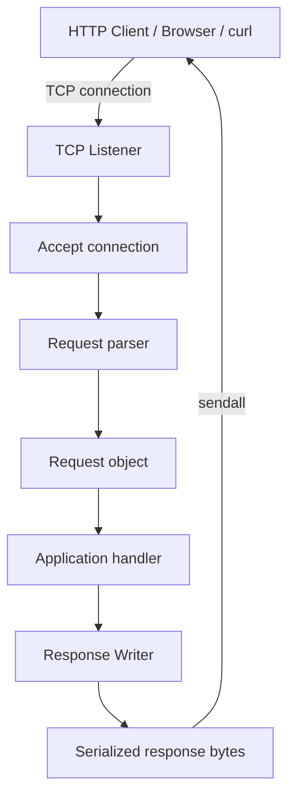
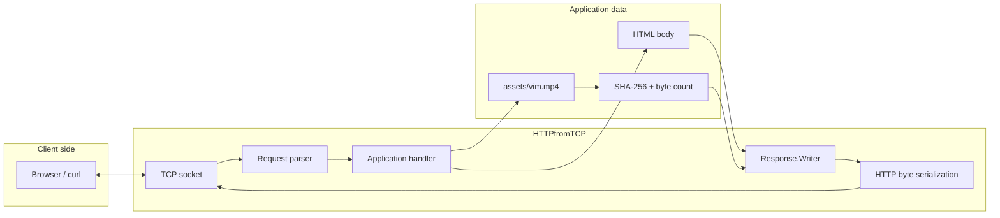
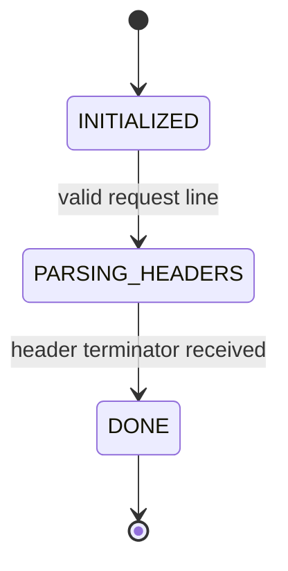
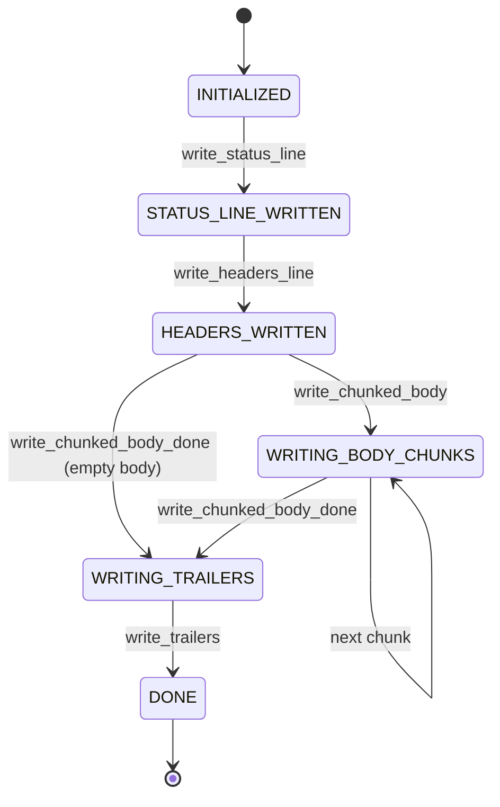
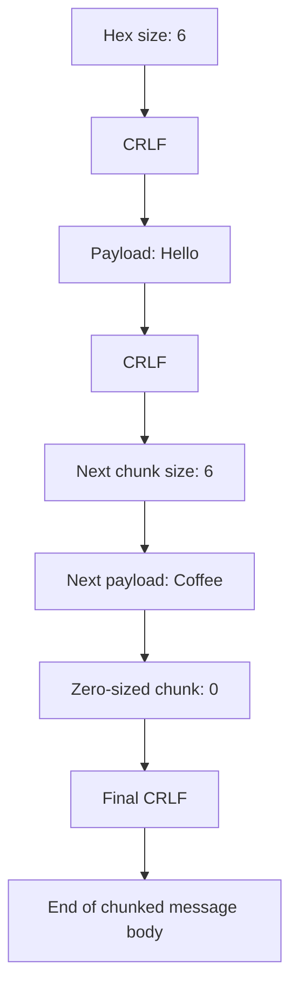
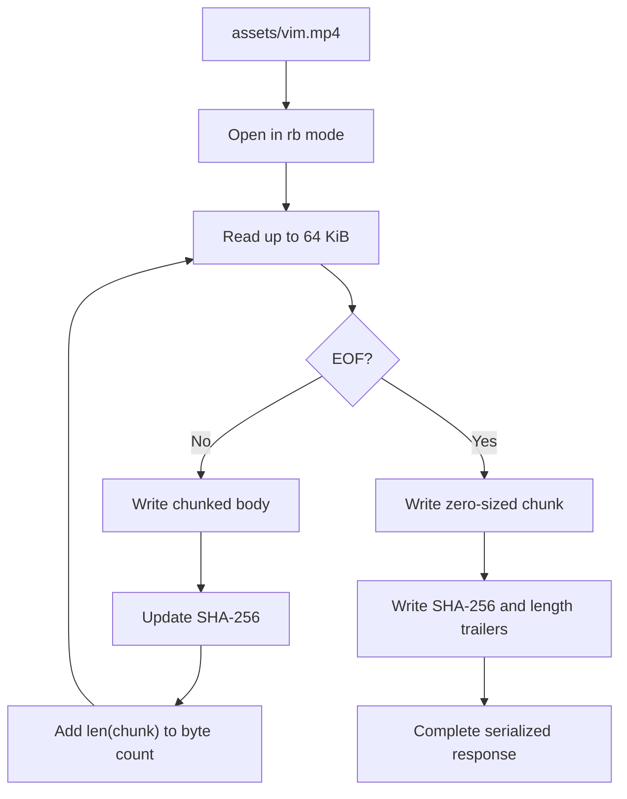
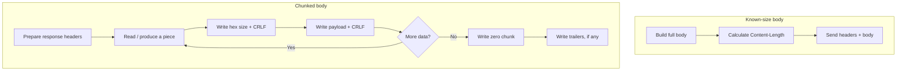
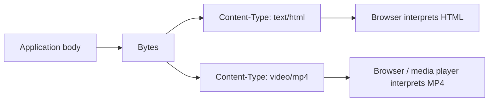

# HTTPfromTCP

> A from-scratch HTTP/1.1 server in Python, built on raw TCP sockets.

**HTTPfromTCP** is an educational HTTP server project that explores what frameworks normally hide: TCP connection handling, HTTP request parsing, header validation, response serialization, chunked transfer encoding, trailers, binary payloads, and the boundary between protocol code and application handlers.

The project is intentionally built in small steps rather than starting with a mature framework. Each layer is implemented explicitly so that the HTTP wire format and the server's responsibilities remain visible.

> **Project status:** Learning project / protocol implementation in progress. It is not yet a production-ready web server. See [Limitations](#current-limitations-and-production-readiness) and [Production roadmap](#production-roadmap).

---

## Contents

- [What this project demonstrates](#what-this-project-demonstrates)
- [Architecture at a glance](#architecture-at-a-glance)
- [Request lifecycle](#request-lifecycle)
- [Response lifecycle](#response-lifecycle)
- [Chunked transfer encoding](#chunked-transfer-encoding)
- [HTTP trailers and integrity metadata](#http-trailers-and-integrity-metadata)
- [Binary data and video responses](#binary-data-and-video-responses)
- [Repository structure](#repository-structure)
- [Implementation details](#implementation-details)
- [Requirements](#requirements)
- [Setup](#setup)
- [Run the server](#run-the-server)
- [Try the endpoints](#try-the-endpoints)
- [Inspect the wire format](#inspect-the-wire-format)
- [Run tests](#run-tests)
- [How the pieces fit together](#how-the-pieces-fit-together)
- [Current limitations and production readiness](#current-limitations-and-production-readiness)
- [Production roadmap](#production-roadmap)
- [Learning notes](#learning-notes)
- [Contributing](#contributing)
- [License](#license)

---

## What this project demonstrates

The repository currently contains an explicit implementation of several HTTP server building blocks:

| Area | What is implemented |
|---|---|
| TCP | A listening TCP socket accepts client connections on `localhost:42069`. |
| Request line | Parses the method, request target, and HTTP version from the request line. |
| Headers | Parses header lines, validates header-name token characters, normalizes names to lowercase, trims optional whitespace around values, and combines repeated fields. |
| Request state | Uses a small state machine to move from request-line parsing to header parsing and completion. |
| Request body | Contains a `Content-Length`-based body-reading helper that writes request bytes to a file. |
| Handler abstraction | Separates request-specific application behavior from the connection loop. |
| Response writer | Writes status lines, headers, and body data through a reusable writer abstraction. |
| Chunked transfer encoding | Frames body pieces with hexadecimal byte lengths and CRLF delimiters. |
| Trailers | Announces trailer names up front and writes trailer fields after the zero-sized terminal chunk. |
| Binary response | Reads an MP4 file as bytes and returns it with `Content-Type: video/mp4`. |
| Integrity metadata | Computes SHA-256 incrementally and counts raw body bytes for the video response trailers. |

The goal is not to recreate every feature of a mature HTTP server. The goal is to understand the mechanics well enough to know what a framework is doing on your behalf.

## Architecture at a glance

The server is built as a sequence of small components. The request parser understands incoming bytes; the application handler decides what to return; and the response writer serializes the HTTP response.

### High-level architecture



### Layer responsibilities

| Layer | Responsibility | Should not own |
|---|---|---|
| TCP listener | Bind, listen, accept, and manage the socket lifecycle | Route-specific business logic |
| Request parser | Interpret request-line and header bytes | Decide application behavior |
| Request model | Hold parsed request information | Serialize the outgoing response |
| Application handler | Choose response status, headers, and body | Parse raw TCP framing |
| Response writer | Serialize status line, headers, body chunks, and trailers | Decide which route should run |
| Socket | Transport bytes | Understand HTTP semantics |

### Excalidraw-style conceptual system map

This is a deliberately hand-drawn-style map of the conceptual boundaries. It is a design illustration, not a claim that the current implementation has every production component shown.



---

## Request lifecycle

A request arrives as a stream of bytes. TCP does not preserve HTTP line boundaries or application-level message boundaries, so the parser has to identify the request-line terminator and then the header section terminator.

The implemented parser currently follows this sequence:

1. Read bytes from the connection's file-like reader.
2. Accumulate bytes until the request line ends in CRLF.
3. Parse the request method, target, and version.
4. Continue parsing the header section.
5. Stop after the empty line that separates headers from a body.
6. Preserve bytes already read beyond the parsed header boundary for the body-reading layer.

### Request parsing state



The request model currently carries the parsed request line and a `Headers` object. A private reader reference is used by the existing body parser.

### Request-line example

Incoming bytes:

```http
POST /upload HTTP/1.1
Host: localhost:42069
Content-Length: 12
Content-Type: text/plain

Hello Coffee
```

The parser extracts:

| Field | Value |
|---|---|
| Method | `POST` |
| Request target | `/upload` |
| HTTP version | `1.1` |
| Host | `localhost:42069` |
| Content-Length | `12` |
| Content-Type | `text/plain` |

**Important protocol distinction:** the HTTP request body is not automatically the response body. The application handler decides what to return. Request and response framing are independent.

---

## Response lifecycle

The response writer encapsulates the wire-format details so application handlers do not have to concatenate a status line, headers, separators, and body bytes manually.

The current writer supports:

- `write_status_line(status_code)`
- `write_headers_line(headers)`
- `write_chunked_body(data)`
- `write_chunked_body_done()`
- `write_trailers(trailers)`

The writer maintains a state to prevent operations from being called in an invalid order.

### Response state machine



The response is assembled in this order:

```text
Status-Line CRLF
Header-1 CRLF
Header-2 CRLF
...
CRLF
Message Body
```

The blank line is mandatory. It separates the header section from the body.

### Application handler boundary

The handler receives a writer and a parsed request. It chooses the status code, creates headers, and writes the body. The server invokes the handler and transmits the resulting response bytes.

```python
def app_handler(writer, request):
    # 1. Inspect request.request_line.request_target
    # 2. Choose status
    # 3. Create response headers
    # 4. Call writer.write_status_line(...)
    # 5. Call writer.write_headers_line(...)
    # 6. Write body bytes
    ...
```

The current handler is in `internals/response/response.py` alongside the writer implementation.

---

## Chunked transfer encoding

A normal response can use `Content-Length` when the complete body size is already known.

For data produced over time—or data whose final length is not known before transmission—HTTP/1.1 can use:

```http
Transfer-Encoding: chunked
```

Each chunk contains:

1. A hexadecimal chunk size.
2. CRLF.
3. Exactly that many payload bytes.
4. CRLF.

The last chunk has a size of zero.

### Example

Original body:

```text
Hello Coffee
```

Chunked wire representation:

```text
6\r\n
Hello \r\n
6\r\n
Coffee\r\n
0\r\n
\r\n
```

The hexadecimal size is the number of **payload bytes in that chunk**, not the number of characters in the whole response.

| Payload | Decimal byte count | Hexadecimal chunk size |
|---|---:|---|
| `Hello` | 5 | `5` |
| `Hello World` | 11 | `b` |
| `Never go full Java` | 18 | `12` |

The HTTP client sees `Transfer-Encoding: chunked`, parses the size lines, reads each chunk, removes the framing, and reconstructs the original body. TCP itself does not understand chunks; chunk framing is an HTTP-level concern.

### Chunk framing diagram



### Implementation notes

The current `Writer.write_chunked_body()`:

- Accepts a `bytes` payload.
- Calculates the byte length with `len(p)`.
- Encodes that size in hexadecimal.
- Writes the size, CRLF, payload, and trailing CRLF.
- Allows more than one chunk.

The current `write_chunked_body_done()` writes the zero-sized chunk prefix. `write_trailers()` writes trailer fields and the final CRLF.

Do not send both `Content-Length` and `Transfer-Encoding: chunked` for the same response. They describe competing message-framing mechanisms.

---

## HTTP trailers and integrity metadata

Trailers are HTTP fields sent after the body chunks. They are useful for metadata that is only available once the body has been completely processed.

The initial headers announce which trailer names will appear:

```http
Transfer-Encoding: chunked
Trailer: X-Content-SHA256, X-Content-Length
```

After the body and zero-sized chunk, the server writes:

```http
0
X-Content-SHA256: <64-character-hex-digest>
X-Content-Length: <raw-body-byte-count>

```

### What the two trailers mean

| Trailer | Meaning |
|---|---|
| `X-Content-SHA256` | SHA-256 digest of the original response-body bytes |
| `X-Content-Length` | Total number of original response-body bytes |

The SHA-256 value is represented as a 64-character hexadecimal string. It is not an integer. It does not include HTTP chunk sizes or CRLF framing.

### Incremental hashing

For a large body, the entire body does not need to be retained in memory just to compute its hash. A hasher can be updated as each piece arrives:

```python
import hashlib

hasher = hashlib.sha256()
total_length = 0

while True:
    chunk = upstream.read(1024)
    if not chunk:
        break

    hasher.update(chunk)
    total_length += len(chunk)
    writer.write_chunked_body(chunk)

digest = hasher.hexdigest()
```

This is the pattern intended for the HTTPBin proxy/trailer exercise. The exact upstream proxy route is a planned extension; the currently inspected committed handler does not yet implement it.

**Integrity note:** A plain SHA-256 digest can detect accidental mismatches when the client independently computes and compares the hash. It is not an authenticated integrity mechanism against an attacker who can modify both the body and the digest. Use a keyed MAC or digital signature when authenticity is required.

---

## Binary data and video responses

HTTP is not restricted to text payloads. The body is a sequence of bytes; `Content-Type` tells the client how to interpret those bytes.

For an MP4 video, the media type is:

```http
Content-Type: video/mp4
```

The current `/video` handler:

1. Opens `assets/vim.mp4` in binary mode.
2. Reads the file in 64 KiB pieces.
3. Writes each piece through the chunked response writer.
4. Updates a SHA-256 hasher with the original video bytes.
5. Counts the original video bytes.
6. Writes the terminating chunk.
7. Writes `X-Content-SHA256` and `X-Content-Length` trailers.

### Binary response path



The file is opened in binary mode, and its bytes are not decoded as UTF-8. This matters because MP4 data is arbitrary binary content, not text.

### Asset setup

The video asset is deliberately excluded from Git using the `assets/` entry in `.gitignore`. Download it locally:

```bash
mkdir -p assets

curl -L -o assets/vim.mp4 \
  https://storage.googleapis.com/qvault-webapp-dynamic-assets/lesson_videos/vim-vs-neovim-prime.mp4
```

Then start the server and open:

`http://localhost:42069/video`

Or save the response to a file:

```bash
curl -v http://localhost:42069/video -o received.mp4
```

Compare the downloaded file with the original:

```bash
cmp -s assets/vim.mp4 received.mp4 \
  && echo "MATCH: files are identical" \
  || echo "MISMATCH: files differ"
```

### Important distinction: chunk encoding vs. true streaming

The current application reads the video file incrementally in 64 KiB pieces and writes chunked framing. However, the inspected `tcplistener/main.py` creates a `BytesIO` response buffer, invokes the handler, then calls `getvalue()` and `conn.sendall()`.

That means the current implementation **constructs the complete serialized response in memory before sending it**. It avoids reading the entire MP4 into one separate file-content variable, but it still accumulates the chunk-framed response in `BytesIO`.

This is chunked transfer encoding, but not yet end-to-end socket streaming. A future socket-backed writer should emit headers and chunks to the client as the file is read.

---

## Repository structure

The current repository is organized around the request parser, header parser, response writer, and TCP listener.

```text
HTTPfromTCP/
├── internals/
│   ├── headers/
│   │   ├── __init__.py
│   │   ├── headers.py
│   │   └── test_headers.py
│   ├── requests/
│   │   ├── __init__.py
│   │   ├── request.py
│   │   └── test_request.py
│   └── response/
│       └── response.py
├── tcplistener/
│   └── main.py
├── .gitignore
└── ...
```

The `assets/` directory is created locally when the video is downloaded and is ignored by Git.

### Main modules

| File | Responsibility |
|---|---|
| `internals/headers/headers.py` | Header model, parser state, header parsing and normalization |
| `internals/requests/request.py` | Request-line parsing, request state, reader integration, and request-body helper |
| `internals/response/response.py` | Status codes, response writer state machine, response serialization, chunked body, trailers, and application handler |
| `tcplistener/main.py` | TCP listener, request parsing invocation, handler invocation, response buffer, and socket send |

---

## Implementation details

### Header parsing

The header parser currently:

- Searches for the header-section terminator.
- Splits individual header lines on CRLF.
- Requires a colon separator.
- Validates header names against HTTP token characters.
- Converts names to lowercase for case-insensitive lookup.
- Trims optional spaces and tabs around values.
- Combines repeated header names with comma-space.

The tests cover valid and invalid names, whitespace, multiple headers, repeated names, empty sections, incomplete input, and different reader chunk sizes.

### Request parsing

The request parser currently:

- Waits for a complete request line ending in CRLF.
- Expects three request-line components.
- Accepts uppercase method tokens.
- Validates the HTTP version against HTTP/1.1.
- Transitions from request-line parsing to header parsing and then to completion.
- Stores a reader reference for the existing request-body helper.

The request-body helper uses the request's `Content-Length` and writes bytes to a local body file. Request-body support and message framing need additional hardening before production use; see the roadmap.

### Response writer

The writer uses a state machine to require the response operations in order. It has an underlying binary writer, HTTP version, and current state.

It serializes:

- Status line with reason phrase.
- Response headers, each terminated by CRLF.
- The empty CRLF line separating headers from body.
- Chunk-size lines in lowercase hexadecimal.
- Chunk payload bytes.
- Chunk-ending CRLF.
- The zero-sized chunk.
- Trailer fields and the final CRLF.

### Application handler

The current handler supports the HTML routes and the local video route:

| Request target | Status | Content-Type | Body behavior |
|---|---:|---|---|
| `/yourproblem` | 400 | `text/html` | HTML error body |
| `/myproblem` | 500 | `text/html` | HTML error body |
| Other paths, including `/coffee` | 200 | `text/html` | HTML success body |
| `/video` | 200 | `video/mp4` | Chunked binary video with SHA-256 and length trailers |

The current handler uses chunked transfer encoding and trailer metadata for its HTML and video responses.

---

## Requirements

The code inspected in the repository uses Python's standard library for sockets, binary file I/O, HTTP status phrases, and hashing, and Pydantic for data models.

Recommended environment:

- Python 3.10+ (the code uses modern union type syntax such as `str | None`).
- `pydantic`
- `pytest` for running the test suite.

No production dependency manager or pinned dependency manifest was present in the inspected repository snapshot. Adding one is a recommended improvement.

---

## Setup

Clone the repository:

```bash
git clone https://github.com/GenZ-CODER-X/HTTPfromTCP.git
cd HTTPfromTCP
```

Create and activate a virtual environment:

```bash
python -m venv .venv
source .venv/bin/activate
```

Install the currently required packages:

```bash
python -m pip install pydantic pytest
```

Download the optional video asset:

```bash
mkdir -p assets
curl -L -o assets/vim.mp4 \
  https://storage.googleapis.com/qvault-webapp-dynamic-assets/lesson_videos/vim-vs-neovim-prime.mp4
```

The video is not committed to the repository; `assets/` is ignored.

---

## Run the server

Run the server as a module from the project root:

```bash
python -m tcplistener.main
```

The current listener binds to:

`localhost:42069`

Module execution is important for this repository's absolute imports. Running the file directly as `python tcplistener/main.py` can make the project root unavailable on the import path and cause imports such as `internals.requests.request` to fail.

Expected startup message:

```text
Waiting for connection
```

Stop the server with Ctrl+C.

---

## Try the endpoints

With the server running, open a second terminal.

### Success response

```bash
curl -i --http1.1 http://localhost:42069/coffee
```

Expected status:

```http
HTTP/1.1 200 OK
Content-Type: text/html
Transfer-Encoding: chunked
Trailer: X-Content-SHA256, X-Content-Length
```

### Client error response

```bash
curl -i --http1.1 http://localhost:42069/yourproblem
```

Expected status: `400 Bad Request`, with an HTML body.

### Server error response

```bash
curl -i --http1.1 http://localhost:42069/myproblem
```

Expected status: `500 Internal Server Error`, with an HTML body.

### Video response

```bash
curl -v --http1.1 http://localhost:42069/video -o received.mp4
```

Expected response metadata:

```http
HTTP/1.1 200 OK
Content-Type: video/mp4
Transfer-Encoding: chunked
Trailer: X-Content-SHA256, X-Content-Length
```

The response should contain the MP4 bytes framed as chunks and end with the integrity trailers.

---

## Inspect the wire format

Curl normally decodes chunked transfer coding before showing the response body. Use `--raw` to preserve the transfer framing in its output:

```bash
curl --raw -i --http1.1 http://localhost:42069/coffee
```

A raw response should show the hexadecimal size before each chunk, CRLF delimiters, the zero-sized terminating chunk, and then the trailer fields.

You can also use netcat to inspect a raw HTTP exchange:

```bash
printf 'GET /coffee HTTP/1.1\r\nHost: localhost:42069\r\nConnection: close\r\n\r\n' \
  | nc localhost 42069
```

For the video endpoint:

```bash
printf 'GET /video HTTP/1.1\r\nHost: localhost:42069\r\nConnection: close\r\n\r\n' \
  | nc localhost 42069
```

---

## Run tests

Run the tests from the repository root:

```bash
python -m pytest -v
```

Run the header tests:

```bash
python -m pytest -v internals/headers/test_headers.py
```

Run the request tests:

```bash
python -m pytest -v internals/requests/test_request.py
```

The request test module currently also contains a parameterized HTTP handler integration test that expects a server to be running at `localhost:42069` and expects the older plain-text response behavior. Those expectations should be updated to match the current HTML/chunked implementation or moved into a dedicated integration-test module.

The Boot.dev CLI can also run lesson-specific tests when installed and authenticated. Each lesson provides its own run command in the Boot.dev interface.

---

## How the pieces fit together

### Fixed-length response vs. chunked response



### Binary response vs. text response

Both are carried as bytes at the HTTP layer. The difference is the meaning assigned by the media type.



The response body should not be decoded as UTF-8 merely because HTTP headers are textual. Binary formats such as MP4 must remain unchanged.

---

## Current limitations and production readiness

This repository is an educational implementation. It should not be exposed directly to the public internet or used as a production server without significant work.

The following limitations are visible in or follow directly from the current implementation:

1. **Single-threaded connection handling.** The accept loop processes a connection inline. A slow client can prevent the server from accepting and processing other clients concurrently.
2. **Buffered response delivery.** The connection handler writes the response into `BytesIO` and sends the complete serialized bytes after the handler returns. The video file is read piece by piece, but the complete serialized response is still accumulated in memory before network transmission.
3. **Limited HTTP request support.** The request parser currently handles a request line and headers. It does not yet implement complete body framing for every HTTP/1.1 transfer mode, request chunked encoding, or a comprehensive message parser.
4. **Limited connection semantics.** Persistent connections, pipelining, robust keep-alive behavior, and graceful per-connection lifecycle management are not fully implemented.
5. **Limited error handling.** Malformed requests, disconnects, file-not-found cases, and unexpected application exceptions need consistent HTTP error mapping and cleanup.
6. **No production routing layer.** The handler currently checks a small number of request targets directly rather than using a dedicated router.
7. **No request limits or timeouts.** Header size, body size, read duration, write duration, and idle connection limits need to be enforced.
8. **No TLS termination.** The current listener is a plain TCP/HTTP server. HTTPS would require a TLS layer or deployment behind a TLS-terminating reverse proxy.
9. **No observability stack.** Structured request logs, metrics, tracing, and error reporting are not implemented.
10. **No pinned dependency manifest or CI workflow** was present in the inspected repository snapshot.

These are opportunities for learning and hardening—not reasons to dismiss the project. The explicit implementation makes the hidden responsibilities easier to inspect.

---

## Production roadmap

The following is a proposed roadmap, not a list of features currently implemented.

### Phase 1 — Correctness and protocol hardening

**Goal:** Make parsing and serialization robust before adding concurrency or performance optimizations.

- Implement strict request-line and header parsing tests.
- Reject malformed or conflicting message-framing headers.
- Validate `Content-Length` values and impose maximum sizes.
- Implement request-body reading that handles partial reads and EOF correctly.
- Add chunked request-body parsing if the server will accept chunked uploads.
- Prevent response framing ambiguity: enforce the correct use of `Content-Length` versus `Transfer-Encoding`.
- Validate trailer announcements and trailer field names.
- Ensure the terminal chunk and trailer terminator are always written exactly once.
- Add tests for zero-length bodies, empty chunks, partial socket writes, early disconnects, and malformed chunks.

### Phase 2 — True streaming and bounded memory

**Goal:** Make memory use independent of total response size.

- Replace the response-wide `BytesIO` with a socket-backed binary writer for live responses.
- Make writer methods write to the underlying destination as data is produced.
- Preserve a separate in-memory writer for deterministic unit tests.
- Add backpressure handling so a slow client slows the producer instead of causing unbounded buffering.
- Stream binary files directly from disk to the socket.
- Stream proxy responses from upstream to downstream without buffering the entire body.
- Calculate SHA-256 incrementally with `hashlib.sha256().update(chunk)`.
- Track byte counts incrementally without retaining all body bytes.

### Phase 3 — Concurrency and connection lifecycle

**Goal:** Handle multiple clients without one slow connection blocking the server.

- Introduce a bounded worker-thread pool or an asynchronous I/O architecture.
- Set connection, read, and write timeouts.
- Implement graceful shutdown and cancellation.
- Handle client disconnects and broken pipes without crashing the listener.
- Add per-connection resource cleanup and lifecycle tests.
- Consider connection limits and admission control.

### Phase 4 — Routing and application boundaries

**Goal:** Make the server extensible without mixing routing, protocol code, and business logic.

- Add a dedicated router with method and path matching.
- Support route parameters and query-string parsing.
- Add middleware hooks for logging, authentication, request IDs, and error handling.
- Separate response models, serialization, and transport writing.
- Add consistent 404, 405, 413, 431, and 500 responses.
- Keep application handlers independent from the raw socket.

### Phase 5 — HTTP feature coverage

**Goal:** Add HTTP features in a deliberate, testable order.

- Implement `HEAD` behavior.
- Add byte-range support (`Range`, `206 Partial Content`, `Content-Range`) for video seeking.
- Implement conditional requests using ETag and Last-Modified.
- Add explicit keep-alive and connection-close behavior.
- Add request and response trailers validation.
- Consider HTTP/2 only after HTTP/1.1 framing and connection management are solid.

### Phase 6 — Security

**Goal:** Prevent malformed traffic and resource exhaustion from compromising the server.

- Add TLS support directly or deploy behind a trusted reverse proxy.
- Enforce request-target and header validation.
- Prevent request smuggling by rejecting ambiguous framing.
- Restrict proxy destinations to avoid open-proxy and SSRF vulnerabilities.
- Set body, header, connection, and execution limits.
- Avoid logging secrets and sensitive request bodies.
- Add dependency scanning and security-focused regression tests.
- Define a clear trust boundary for forwarded headers.

### Phase 7 — Observability and operations

**Goal:** Make behavior diagnosable in real deployments.

- Structured JSON logs with request IDs.
- Metrics for request count, status codes, bytes in/out, latency, and active connections.
- Traces across proxy/upstream calls.
- Health and readiness endpoints.
- Graceful configuration management.
- Docker image and reproducible deployment setup.
- CI that runs formatting, linting, type checks, unit tests, and integration tests.
- Load tests for throughput, latency, memory, and slow-client behavior.

### Phase 8 — Performance and reliability

**Goal:** Measure before optimizing.

- Benchmark the parser and response writer.
- Compare thread-based and async connection handling.
- Use bounded buffers and tune chunk sizes based on measurement.
- Add upstream connection pooling for proxy traffic.
- Add upstream deadlines and cancellation.
- Introduce retry policies only where safe and appropriate.
- Add load and soak tests.
- Profile memory allocations and CPU hotspots.

---

## Learning notes

A few core ideas this project is designed to make tangible:

- **TCP is a byte stream.** It does not preserve application-level message boundaries.
- **HTTP framing is separate from TCP.** The client interprets `Content-Length`, chunked transfer coding, or connection closure to determine where a message body ends.
- **Headers are metadata.** `Content-Type` describes how the body should be interpreted; it does not transform the bytes.
- **Binary content is still bytes.** An MP4 body must not be decoded as text.
- **Chunk sizes are hexadecimal byte counts.** They describe each chunk's payload, not the whole response.
- **Trailers arrive after the terminating zero-sized chunk.** Their names should be announced in the initial `Trailer` header.
- **Hash the representation, not its transfer framing.** SHA-256 must be calculated over the original body bytes, not chunk size lines or CRLF delimiters.
- **Chunked encoding is not the same as live streaming.** A program can construct a complete chunked response in memory and send it later. True streaming requires forwarding each produced chunk to the client as it becomes available.

---

## Contributing

This project is being developed as a learning exercise. Contributions and suggestions are welcome, especially around:

- Protocol correctness.
- Parser edge cases.
- Writer state-machine design.
- Bounded-memory streaming.
- Concurrency and backpressure.
- Test coverage.
- Documentation and architecture diagrams.

Suggested workflow:

1. Open an issue describing the behavior or protocol case.
2. Keep changes focused on one layer.
3. Add tests for valid and invalid inputs.
4. Run the complete test suite.
5. Document any intentional protocol limitations.

## License

No license file was present in the repository snapshot inspected when this README was prepared. Until a license is added, the repository should not be assumed to grant standard open-source reuse permissions.

---

## Acknowledgements

Built as a hands-on exploration of TCP and HTTP internals, following the progression of the Boot.dev HTTP server course while implementing the concepts in Python.

Repository: [GenZ-CODER-X/HTTPfromTCP](https://github.com/GenZ-CODER-X/HTTPfromTCP)
